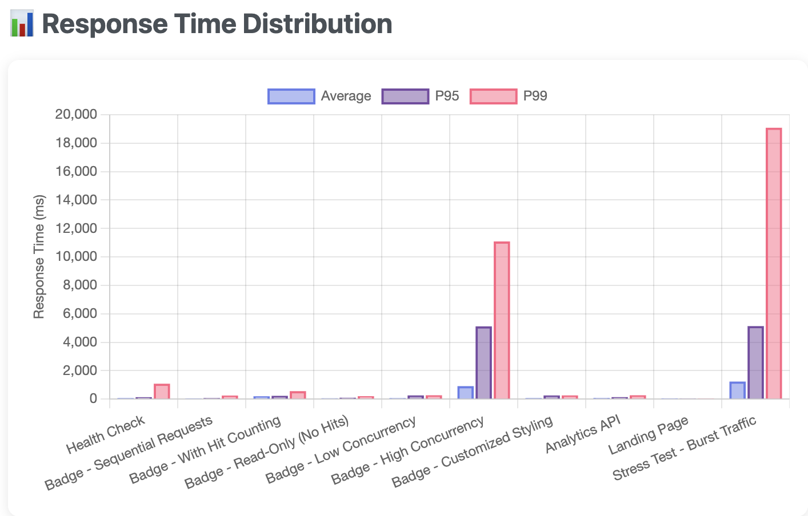

# Visitor Badge Reloaded ✨


<!-- TODO: host this with VBR too -->

[](https://github.com/Nathan13888/VisitorBadgeReloaded/blob/master/LICENSE)


**Visitor Badge Reloaded** began as a faster, maintained, and more customizable replacement
for [visitor-badge](https://github.com/jwenjian/visitor-badge).

It now provides configurable visitor-count badges, traffic analytics, and rate-limited web
and API access while remaining compatible with the original service.

---

## 🏎️ Benchmarks

> See [benchmark/README.md](benchmark/README.md) for details.

**Results:**



| Test Name | Requests | Success Rate | Avg Response | P95 | P99 | Throughput |
| :--- | :--- | :--- | :--- | :--- | :--- | :--- |
| **Health Check** | 100 | 100.00% | 73.21ms | 137.28ms | 1084.86ms | 70.41 req/s |
| **Badge - Sequential Requests** | 50 | 100.00% | 53.13ms | 76.75ms | 253.03ms | 15.75 req/s |
| **Badge - With Hit Counting** | 100 | 100.00% | 205.76ms | 233.94ms | 563.20ms | 20.99 req/s |
| **Badge - Read-Only (No Hits)** | 100 | 100.00% | 59.65ms | 98.79ms | 208.14ms | 59.84 req/s |
| **Badge - Low Concurrency** | 100 | 100.00% | 71.73ms | 264.17ms | 272.44ms | 87.99 req/s |
| **Badge - High Concurrency** | 200 | 100.00% | 918.29ms | 5121.83ms | 11090.42ms | 17.04 req/s |
| **Badge - Customized Styling** | 100 | 100.00% | 74.43ms | 258.76ms | 263.12ms | 97.39 req/s |
| **Analytics API** | 50 | 100.00% | 79.96ms | 140.41ms | 272.62ms | 69.08 req/s |
| **Landing Page** | 50 | 100.00% | 22.10ms | 32.69ms | 49.65ms | 231.59 req/s |
| **Stress Test - Burst Traffic** | 500 | 100.00% | 1236.31ms | 5134.62ms | 19083.69ms | 9.89 req/s |

Performed on 2025-10-19 using a Macbook (M4 Pro) with a ~12.6ms average network latency to Cloudflare.

**Quick Start:**

```bash
# Run a quick performance check (~30 seconds)
bun run benchmark/quick-bench.ts

# Run the full benchmark suite (~5 minutes)
bun run bench

# Generate visual HTML report
bun run bench:report
```

**What's tested:**

- Response time (avg, p50, p95, p99)
- Throughput (requests per second)
- Cache effectiveness
- Concurrent request handling
- Error rates and reliability
- Real-world usage patterns

Results are saved to `benchmark/results/` and can be compared over time to track performance trends.

## ⚙️ Settings

### Badge Options

To use the options, **append** these flags to the URL of the badge!

| Option                 | Flag                     | Description                                                                                                                                                                                                                                                                                                                          |
| ---------------------- | ------------------------ | ------------------------------------------------------------------------------------------------------------------------------------------------------------------------------------------------------------------------------------------------------------------------------------------------------------------------------------ |
| **Colour**             | `&color=<colour>`        | Background colour of the count, on the **right-side** of the badge. Takes a hex value without the `#`, one of Shields' names (`blue`, `brightgreen`, `critical`, ...), or any CSS colour.                                                                                                                                              |
| **Label Colour**       | `&lcolor=<colour>`       | Background colour of the label, on the **left-side** of the badge. Same formats as `&color=`.                                                                                                                                                                                                                                        |
| **Style**              | `&style=<style>`         | One of `flat`, `flat-square`, `plastic`, `for-the-badge` or `social`. Anything else falls back to `flat`.                                                                                                                                                                                                                            |
| **Text**               | `&text=<label>`          | Replaces the label on the **left-side** of the badge. A single underscore renders as a space (`Total_Visits`), `__` as a literal underscore, and `--` as a literal dash.                                                                                                                                                              |
| **Label** (legacy)     | `&label=<label>`         | Legacy alias for `&text=`. If both are present, `&text=` takes precedence.                                                                                                                                                                                                                                                          |
| **Custom**             | `&custom=<format>`       | Allows a **custom string format** to be set for the count. Replaces `CNT` with the view count, so `&custom=CNT_visits` renders "42 visits".                                                                                                                                                                                          |
| **Logo**               | `&logo=<logo name>`      | Adds a logo to the badge (refer to examples). Takes any [**Simple Icons**](https://simpleicons.org/) slug (`googlechrome`), the icon title with spaces as dashes (`google-chrome`), or a `data:` URI of your own image.                                                                                                               |
| **Logo Colour**        | `&logoColor=<colour>`    | Recolours the logo. Same formats as `&color=`. Defaults to white; pass an empty value to keep the icon's own brand colour.                                                                                                                                                                                                           |
| **hit**                | `&hit=off`               | **Enabled** by default. Determines if the badge will update the count (useful for duplicated badges or badges for just viewing the count). Anything other than `true` or `yes` — including an empty value — is considered **disabled**. A disabled badge is cached for 15 seconds, so it is much cheaper to serve.                    |

`&cache=` and `&unique=` are gone. Neither did anything: `&cache=` was never read by
the code, and `&unique=` was rejected by request validation before it could be. Caching
is no longer a knob — a badge that counts is never cached, and a badge that does not
count always is. See [Caching](#caching).

**Defaults**:

- Colour: "blue"
- Label Colour: "grey"
- Style: "flat"
- Text: "Visitors"
- Logo: _no logo_
- Logo Colour: "white"
- Hit: _enabled_

### Caching

A badge that counts a view (`&hit=` enabled, the default) is never cached, by
anything. Caching it would let a cache answer GitHub's image proxy on the
service's behalf and silently swallow the view.

A badge that does not count (`&hit=false`) is cached at the Cloudflare location
serving it for 15 seconds, and says so with `Cache-Control: public, max-age=15`.
Within that window it costs no storage access at all. Several differently styled
badges for one `page_id` also share a single count lookup, so a README full of
them is one read rather than one per badge.

Responses carry `X-VBR-Cache: HIT`, `MISS`, or `BYPASS` (for the counted badges
that are never cacheable). Cache entries do not replicate between Cloudflare
locations, so a `MISS` simply means you are the first to ask in that location.

### Rate Limits

Limits exist to bound cost, not to police badges, so they are keyed on the
caller rather than on the badge — a popular badge is not throttled for being
popular.

- **Counting a view** is limited per client, per badge. Over the limit the badge
  still renders normally; the view just is not counted. A rate limit never turns
  a README into a broken image.
- **Badge requests overall** are limited per client, and only checked when the
  cache missed. Far over that limit a client gets a `429` and a "Rate Limit
  Exceeded" badge.
- **Analytics** (`/api/analytics/:pageId` and `/info/:id`) is limited per client
  and returns `429` with `Retry-After`.

Limits are enforced per Cloudflare location and are eventually consistent, so
they are approximate by design.

### Examples 🧪

<!-- TODO: invisible badge option, logo, logo colour, custom text -->

#### Different text background


#### Different label background


#### Different style


#### Different text


#### Different logo


## 🚢 Migrating From Visitor Badge

If you use the original [Visitor Badge](https://github.com/jwenjian/visitor-badge), just replace the domain name:

```
ie. 'visitor-badge.glitch.me/badge?page_id=YOURPAGEID' --> 'https://vbr.nathanchung.dev/badge?page_id=YOURPAGEID'
```

### Options (Old Option) (add as a [HTTP query parameter](https://en.wikipedia.org/wiki/Query_string))

**IMPORTANT: Other than the `page_id` option, there exists additional styling options and functional options (in the future). Badges are rendered with the same library Shields.io uses, so the styling options carry over from [Shields.io](https://shields.io/). Also, all the options are specified as HTTP parameters!!!**

- `page_id=<your id>` --> identifies your badge, make this unique to yourself. eg. `<your username.visitor.badge.reloaded` or `<username>-<username>`
- `color=<colour here>` --> the hex colour of the text background, **do NOT include the `#`**
- `lcolor=<colour here>` --> the hex colour of the label background, **do NOT include the `#`**
- `style=<style name>` --> one of `flat`, `flat-square`, `plastic`, `for-the-badge` or `social`
- `text=<Some text other than "Visitors">` --> put a customizable label on your badge
- `logo` --> logo to put beside the badge, go to <https://simpleicons.org/> for the available names
- `logoColor` --> refer to `color` for the formatting
- `cache` --> **removed**, and never actually did anything. Caching is automatic now; see [Caching](#caching)

## 🥳 Contributing

1. **Star ⭐** this project.
2. **Create an Issue** on Github if there are any issues of feature requests.
3. **Submit PRs**. Refer to [Contributing](#Contributing)

## 📦 Deploying your own instance (self-hosting)

### Cloudflare

```bash
# 1. install dependencies
bun i

# 2. use own workers kv
# update `wrangler.toml` with your own kv namespace id (avoid changing binding name to avoid regenerating types)
# @see https://developers.cloudflare.com/kv/get-started/

# 3. set the visitor hashing secret (any long random string)
# used to derive per-badge, per-day keys for the estimated unique visitor
# metric. It is never persisted, so a storage dump cannot be probed for
# whether a given address visited. Skip this and hit counting still works,
# but the estimate is reported as null rather than falling back to something
# weaker.
wrangler secret put VISITOR_HASH_KEY

# 4. rate limiting needs no setup, but the `namespace_id`s under [[ratelimits]]
# in `wrangler.toml` must be unique within your Cloudflare account. If you run
# other Workers that use rate limiting, renumber them. Leaving the bindings out
# entirely is supported - the limiters fail open and badges keep working.

# 5. deploy to cloudflare
# the Simple Icons set is generated into src/generated/ as part of the build,
# so this needs devDependencies installed (`bun i` above covers it)
bun run deploy
```

## 💻 Software Used

- Cloudflare Workers
- Typescript
- Hono
- [badge-maker](https://www.npmjs.com/package/badge-maker) (the renderer behind shields.io) and [Simple Icons](https://simpleicons.org/), both bundled into the Worker
